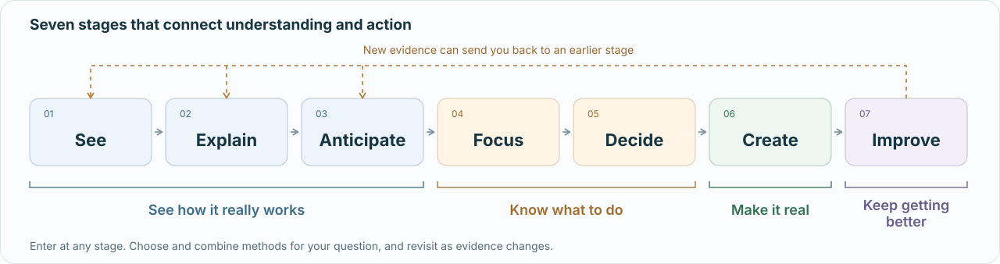

<div align="center">

# OpenXSys: Give your AI top-tier systems thinking!

From understanding one company to researching an entire industry. Bring first principles, systems science and great practitioners’ ways of thinking to the systems behind what you see.

**Every main character has a system. Now you do, too.**

`[OpenXSys] Ding. System activated.`

AI handles the complexity. You own the possibilities.

[](#status)
[](LICENSE)
[](skills/open-x-sys/SKILL.md)
[](docs/INSTALL.md#tools)
[](#status)

[⚡ Ask your AI to install](#start) · [✨ See an actual result](#examples) · [Try one sentence](#try) · [What makes it different](#different) · [The methods](#methods) · [Project structure](#docs) · [Website](https://openxsys.com/?lang=en) · [Chinese](README.zh-CN.md)

</div>

---

**OpenXSys is an open-source, system-level Skill.** A Skill is a capability package an AI can call on repeatedly. OpenXSys connects systems-thinking methods, standards of judgment and practical approaches so your familiar AI tool can apply them to real problems.

Give it a company, a project, a workflow, a decision or your own situation. It looks for structure in the whole, traces causes behind symptoms, finds where effort matters, researches approaches that fit your conditions and turns understanding into useful work.

**See how it really works → Know what to do → Make it real → Keep getting better.**

<a id="examples"></a>

## ✨ One sentence. The entire AI industry.

**Using Doubao Work × DeepSeek v4.1 Flash × OpenXSys Skill**

In this actual run, the author gave the AI one prompt:

```text
/open-x-sys I want to research the entire artificial intelligence industry!
```

The AI produced an explorable industry-research page. It connects applications, models, cloud, chips, memory, packaging and power as one system, follows money flows and capital loops, examines profit and constraints, and explores four future scenarios. The page includes interactive charts, its method route, monitoring signals, discovery cards and a source index.

[](https://openxsys.com/gallery/ai-industry/index.en.html)

[📥 Download the bilingual report and open it in a browser](gallery/ai-industry/ai-industry-bilingual.zip?raw=true) · [English HTML](https://openxsys.com/gallery/ai-industry/index.en.html) · [Chinese HTML](https://openxsys.com/gallery/ai-industry/index.html) · [About this run](gallery/ai-industry/README.md)

*Actual run date: 2026-11-16. The complete report is available in both languages; switch at the top while keeping the current section. Data and source dates are in the report.*

**This run shows how systems thinking can bring more of a model's capabilities into use.** A cost-effective Flash model can apply an expert's ways of framing questions, tracing causes and feedback, and finding constraints. OpenXSys Skill supplies those methods, grounded in systems science, so research that calls for carefully structured prompts and step-by-step human guidance can begin with an everyday sentence.

Try an industry, company, technology or social phenomenon you care about. Start with one sentence.

**The next great result could be yours.** Proud of something you made with OpenXSys? Upload it to GitHub and submit it to the gallery, together with your prompt, AI tool and model.

[Showcase your work](gallery/README.md#share-your-work) · [Explore this repository](#docs)

<a id="start"></a>

## ⚡ Ask the AI you already use to install it

Share this project link with your AI, or download and attach the [complete English skill package](dist/open-x-sys.zip?raw=true), then copy:

```text
Please install OpenXSys from the project link or complete skill package I shared.
Use the installation method for the AI tool you are running in, install the complete English edition, and check that it is available.
Tell me when it is ready. I will then ask my own question.
```

Tool entry points: [WorkBuddy](docs/INSTALL.md#tools) · [Doubao Work](docs/INSTALL.md#tools) · [DSH](docs/INSTALL.md#tools) · [Claude Code](docs/INSTALL.md#tools) · [Codex](docs/INSTALL.md#tools) · other AI tools with skill support.

You can also import the complete package through your tool's skill manager. See the [installation guide](docs/INSTALL.md) for installation, updates and removal. A [complete Chinese package](dist/open-x-sys.zh-CN.zip?raw=true) is available too.

<a id="try"></a>

## ✨ Now ask one question

```text
Use OpenXSys to research the entire artificial intelligence industry.
```

Or ask your own question. Speak normally: the AI selects and combines methods based on the subject, your purpose and your actual conditions.

| What you want to do | Example prompt |
|---|---|
| Understand something | "Open a system for Musk's companies." |
| Think a problem through | "Break the cost of a home battery down to first principles." |
| Find where improvement matters | "We keep redoing work. What really limits our delivery?" |
| Make a choice | "Given my current situation, what is the best way to start making short videos?" |
| Improve a piece of work | "Run Musk's algorithm on our release process." |
| Make a deliverable | "Turn those findings into a proposal I can discuss with my team." |
| Understand your own system | "Open a system for me." |

As work unfolds, short signals show what the methods are doing. Here is an example of the format:

```text
[OpenXSys] Ding. System activated.
[OpenXSys] Run X-ray: map the AI industry. Who creates value, and who captures the profit?
[OpenXSys] Run Bottleneck: as models get cheaper, what becomes the next constraint on the whole industry?
[OpenXSys] Deliverable ready: the industry landscape, key loops, four futures and an explorable research page.
```

Each step serves the current question. You can say "Try another angle," "Invert it first" or "Make it real," or ask why a method was chosen.

<a id="different"></a>

## What makes it different

**OpenXSys packages how to understand and improve a system into capabilities an AI can use.** You keep using your model, agent, tools and specialized Skills. OpenXSys organizes their use around your particular problem.

An expert using AI frames the question, brings in missing perspectives, traces causes and revises judgments against evidence. OpenXSys Skill turns that way of guiding research into methods the AI can read and apply, so an everyday question can start an expert approach to thinking.

| Capabilities you already have | How OpenXSys organizes and applies them |
|---|---|
| A model's understanding, reasoning and generation | Builds an understanding of the subject through the whole, causes, feedback, constraints, scale and time |
| An agent's research, planning and execution | Selects methods and routes for the question, carrying findings into later judgments and actions |
| Search, data, tools and specialized Skills | Researches conditions of use, compares and connects capabilities, and develops practices that fit the current system |
| Your material, projects and existing work | Accumulates understanding, practices and connections so the next session builds on what is already there |

Four connected parts make this work:

- **Thinking that carries through.** From seeing, explaining and anticipating to focusing, deciding, creating and improving. Each method page includes cues for use, quality standards, common pitfalls and its intellectual sources.
- **Practice researched for real conditions.** An independent creator and a team can need different ways to make videos with AI. Recommendations carry evidence, costs, conditions and a low-cost first validation.
- **Understanding made useful.** A proposal, an explorable page, a video or a working capability. The form follows the problem and the capabilities available.
- **Understanding and capabilities that last.** Each run preserves what is understood about the subject and what you already understand. Return, continue the work and adjust as new evidence arrives.

You leave with a better understanding of this problem, something you can use and a system you can keep developing.

<a id="results"></a>

## What a run leaves you with

| What stays | How you use it |
|---|---|
| **A finding worth seeing** | Understand the important structure, causes and constraints, with the basis for the judgment and the remaining unknowns |
| **A finished deliverable** | Understand, discuss, act or share: a page, document, proposal, presentation, tool or, with the capabilities available, video |
| **A route strip** | See which methods were used and why; replace a step or take it further |
| **A next step that fits** | Compare practices, weigh choices and start with a low-cost validation |
| **A share pack** | Discovery cards, draft copy and image descriptions, plus a short clip when video capabilities are available; you choose how to share |
| **A system you can continue** | Keep understanding, practices, capabilities, sources and deliverable entries, then return to carry the work forward |

<a id="methods"></a>

## 🧠 Think like the best

The well-known ways great practitioners work, ready to run by name on anything of yours.

| Master route | The steps | Example prompt |
|---|---|---|
| **[Musk's algorithm](skills/open-x-sys/routes/masters/musk_algorithm.md)** | Question every requirement → delete → simplify → accelerate → automate last | "Run Musk's algorithm on our release process." |
| **[The Toyota way](skills/open-x-sys/routes/masters/toyota_way.md)** | Go and see → ask why five times → countermeasure → standardize → improve again | "Run the Toyota way on our support backlog." |
| **[Goldratt's five focusing steps](skills/open-x-sys/routes/masters/goldratt_five_steps.md)** | Identify the constraint → exploit → subordinate → elevate → repeat | "What is the constraint in my week, and what do I do about it?" |
| **[Munger's checklist](skills/open-x-sys/routes/masters/munger_checklist.md)** | Invert → follow the incentives → use many models → think a level deeper → decide | "Run Munger's checklist on this job offer." |
| **[Feynman's technique](skills/open-x-sys/routes/masters/feynman_technique.md)** | Explain it simply → find the gaps → go back to the source → simplify again | "Use Feynman's technique to teach me how transformers work." |

Also: **[Deming's cycle](skills/open-x-sys/routes/masters/deming_cycle.md)**, **[Boyd's loop](skills/open-x-sys/routes/masters/boyd_loop.md)**, **[Shell's scenarios](skills/open-x-sys/routes/masters/shell_scenarios.md)**. Every route page names its source and says where OpenXSys simplifies it: [routes/masters](skills/open-x-sys/routes/masters).

### From seeing to improving: one connected thinking journey

Seven stages connect understanding, judgment and action. The AI chooses where to begin, combines methods for the question and revisits earlier stages as new evidence arrives.

<picture>
  <source media="(max-width: 640px)" srcset="assets/readme/journey.en.mobile.svg" />
  
</picture>

**The starter seven.** One famous method per stage.

| Stage | Method | Example prompt |
|---|---|---|
| See | **[X-ray](skills/open-x-sys/methods/1-see/xray.md)** | "Show me what really drives ___." |
| Explain | **[First Principles](skills/open-x-sys/methods/2-explain/first_principles.md)** | "Break ___ down to what must be true, and rebuild it." |
| Anticipate | **[Invert](skills/open-x-sys/methods/3-anticipate/invert.md)** | "What would make ___ fail?" |
| Focus | **[Leverage](skills/open-x-sys/methods/4-focus/leverage.md)** | "Where would a small change in ___ matter most?" |
| Decide | **[Best Practice](skills/open-x-sys/methods/5-decide/practice.md)** | "Given what I have, what is the best way to ___?" |
| Create | **[Make](skills/open-x-sys/methods/6-create/make.md)** | "Turn this into a ___." |
| Improve | **[Review](skills/open-x-sys/methods/7-improve/review.md)** | "Let's review ___: what happened, and what should change?" |

The complete library contains **23 core methods, 7 advanced lenses and 10 system patterns**. [Explore all methods](skills/open-x-sys/methods).

**Start by asking your question in ordinary language.** The AI reads the method and route pages needed for the task, chooses a combination and shows what it uses in running signals and the route strip. Follow up on a result, name a method, compose your own route or turn on learn mode to understand and master these ways of thinking.

**Four ways to use it.**

- **Say** one sentence. The system picks the route and runs it at full power.
- **Choose.** Pick a follow-up direction from the result and take the part that interests you further.
- **Combine** methods yourself: "X-ray it, then invert it."
- **Learn** as you go: every result shows which methods were used and why, and learn mode asks you to predict before the reveal.

The AI follows your question and you can steer at any point. [Full skill entry](skills/open-x-sys/SKILL.md) · [Everyday routes](skills/open-x-sys/routes/everyday.md) · [System patterns](skills/open-x-sys/patterns/README.md)

<a id="system"></a>

## Your own system grows with use

A system's core is natural language. It can also include code, data, tool connections and deliverables. OpenXSys describes the role and use of these parts so understanding and capabilities can accumulate through real work.

Say **"Open a system for me."** OpenXSys looks at what you already have, within the scope you allow, and shows you your own situation as a system: one structural finding, the gaps, and two to four practice paths that fit what you have.

Everything it learns is kept in plain files that are yours:

```text
~/.openxsys/                 your system: across projects, AIs and sessions
├── SYSTEM.md                the root entry: you
└── <an opened system>/      one folder for each thing you opened
    └── SYSTEM.md            any AI that reads this can continue

<a project>/.openxsys/       a project's own system, which belongs to the project
```

- You choose where it lives the first time. Nothing is written before you choose.
- It records what the system understands, and what **you** already understand, so the next run starts where you are.
- It is plain text. Read it, change it, delete it, take it to any AI.
- It never stores passwords, keys or sensitive personal information.
- "Open my system" shows your panel: systems opened, practices in use, what is being watched, methods you now use unaided, and the one thing most worth doing now.

Next time, say “Continue.” The AI starts from the system entry, picks up the existing understanding, checks what has changed and proposes a useful next step. [How continuation works](skills/open-x-sys/system/return.md) · [The parts of a system](skills/open-x-sys/system/parts.md)

<a id="explore"></a>

## 🧭 When you want to go further

- **Try another way of thinking.** "Replace that bottleneck analysis with inversion. What else do we find?"
- **Combine methods yourself.** "X-ray it, then follow the incentives, then weigh the options."
- **Learn as you go.** "Turn on learn mode and explain why you see it that way."
- **Return to your own system.** "Open my system. What is most worth doing now?"
- **Visit the Playground.** "Open the playground." Explore ready-made subjects, combinations, comparisons and example systems.

[Four ways to use it](skills/open-x-sys/use.md) · [Playground](playground/README.md) · [Academy](academy/README.md) · [Practices](practices/README.md)

<a id="sources"></a>

## Built on these ideas

| Foundation | What it contributes |
|---|---|
| **A world made of systems** | Understand subjects through their parts, relationships, boundaries, constraints and changes |
| **Systems thinking and great practitioners' approaches** | Form judgments through first principles, bottlenecks, incentives, second-order thinking and more |
| **Systems science** | Ground understanding in feedback, dynamics, complexity, boundaries and scale |
| **Best-practice research** | Discover, compare, adapt, combine, create and keep improving practices that fit |

Each method page names its intellectual sources and the scope of OpenXSys's simplification.

<details>
<summary><strong>The people and works behind the methods</strong></summary>

**Practitioners.** Aristotle (first principles) · Taiichi Ohno, *Toyota Production System* · W. Edwards Deming, *Out of the Crisis* · Joseph Juran (the vital few) · Eliyahu Goldratt, *The Goal* · Charlie Munger, "The Psychology of Human Misjudgment" · Howard Marks, *The Most Important Thing* · Gary Klein (the premortem) · Jane Jacobs, *The Death and Life of Great American Cities* · Pierre Wack (scenarios) · John Boyd (the OODA loop) · Christopher Alexander, *A Pattern Language* · Genrich Altshuller (TRIZ) · Enrico Fermi · Richard Feynman · Fernand Braudel · Jim Collins · Qian Xuesen, Yu Jingyuan and Dai Ruwei (open complex giant systems) · Walter Isaacson's account of Elon Musk's "algorithm".

**Systems scientists.** Norbert Wiener · W. Ross Ashby · Jay W. Forrester · Herbert A. Simon · Douglas Engelbart · Ludwig von Bertalanffy · C. West Churchman · Garrett Hardin and Elinor Ostrom · Robert K. Merton · Stafford Beer · Gregory Bateson · Chris Argyris and Donald Schön · Heinz von Foerster · Peter Checkland · Werner Ulrich · Edward Tufte · W. Brian Arthur · Peter Senge · John H. Holland · Donella Meadows · John Sterman · David Snowden · Bret Victor · Geoffrey West.

Each method page names its sources and scope of interpretation. See the [source notes](docs/SOURCES.md).

</details>

<a id="docs"></a>

## Project documentation and structure

### Repository structure

```text
open-x-sys/
├── README.md                    English project introduction
├── README.zh-CN.md              Chinese project introduction
├── LICENSE                     MIT license
├── VERSION                     Machine-readable release version
├── CHANGELOG.md                Release notes, with a Chinese edition
├── .github/                    Release checks and website workflow
├── skills/
│   ├── open-x-sys.zh-CN/        Complete Chinese Skill; matching structure
│   └── open-x-sys/              Complete English Skill
│       ├── SKILL.md            Identity, principles, overview and document index
│       ├── journey.md          The seven-stage thinking journey
│       ├── use.md              Say, choose, combine and learn
│       ├── methods/            23 core methods and 7 advanced lenses
│       ├── patterns/           10 system patterns and their index
│       ├── routes/             Everyday routes and 8 master routes
│       ├── engines/            Research, understanding, creation and improvement
│       ├── system/             System entries, accumulated understanding and continuity
│       ├── display/            Pages, charts, documents and shareable work
│       ├── styles/             Scientific, plain and optional voices
│       ├── kit/                Connections and choices for extended capabilities
│       └── deps/               Dependencies, lock information and installers
├── gallery/                    Work produced in actual use
│   └── ai-industry/            AI industry study: bilingual pages and run notes
├── playground/                 Ready subjects, method comparisons and example systems
├── academy/                    Method lessons, people and learning paths
├── practices/                  Practices with conditions, evidence and results
├── x-sys/                      Domain-system toolkit and compatibility entry
├── evals/                      Verification, evaluation contributions and feedback
├── docs/                       Installation, overview and source notes
├── dist/                       Complete English and Chinese importable skill packages
├── scripts/                    Package generation and file-by-file verification
├── assets/readme/              Journey diagrams and previews of actual work
└── site/                       Project website
```

### Find the right document

Paths below are relative to the repository root.

| When to read | Document | Path |
|---|---|---|
| Install, change tools, update or uninstall | [Installation guide](docs/INSTALL.md) | `docs/INSTALL.md` |
| Understand the complete Skill and its document connections | [Runtime entry](skills/open-x-sys/SKILL.md) | `skills/open-x-sys/SKILL.md` |
| See how methods connect | [Everyday routes](skills/open-x-sys/routes/everyday.md) | `skills/open-x-sys/routes/everyday.md` |
| Explore deliverable forms and quality | [Display guidance](skills/open-x-sys/display/signature.md) | `skills/open-x-sys/display/signature.md` |
| Connect capabilities or check dependencies | [Dependency guide](skills/open-x-sys/deps/DEPENDENCIES.md), [Kit](skills/open-x-sys/kit/KIT.md) | `skills/open-x-sys/deps/DEPENDENCIES.md`, `skills/open-x-sys/kit/KIT.md` |
| Understand the structure and workflow | [Project overview](docs/OVERVIEW.md) | `docs/OVERVIEW.md` |
| Inspect actual runs and validation | [Evaluation records](evals/README.md) | `evals/` |

### For builders

- **The runtime is natural language.** `SKILL.md` provides the overview and index. Supporting documents develop the methods, routes, engines and standards of judgment; the AI reads and applies them as the task calls for them.
- **Open-X-Sys.** Build Open{Domain}Sys on the kernel and connect your own methods and capabilities: [family toolkit](x-sys/README.md).
- **Kit.** Optional connections for specialized needs: [KIT.md](skills/open-x-sys/kit/KIT.md).
- **Packages.** The [packaging script](scripts/package-skill.ps1) bundles the complete runtime, release version and license, checking every file against its source. The Playground is available separately in the repository.

<a id="status"></a>

## 0.0.1 Alpha Preview

The current focus is to make the complete systems-thinking capability, accessible installation and one-sentence experience work well together.

| Area | Current progress |
|---|---|
| Runtime | Complete English and Chinese editions; 23 core methods, 7 advanced lenses, 10 patterns and 8 master routes |
| Installation | Natural-language instructions and complete ZIPs; isolated-directory install, update and uninstall checks |
| Validation | Both editions checked for supporting-document paths, package contents, versions and public links; actual use records grow by tool and model |
| Extended capabilities | Uses the current AI tool and existing Skills; dependency review progress is in the dependency guide |
| Showcase | A one-prompt industry study from Doubao Work exists; the report supports both languages, with more gallery selections and replays to follow |

The first public version is `0.0.1-alpha.1`. [Acceptance records](evals/README.md) · [Release notes](CHANGELOG.md)

<a id="faq"></a>

## FAQ

**What if I know nothing about systems thinking or prompting?**

Say what you care about. The AI selects methods and routes for the question. Follow up on a finding or result, and change direction whenever you want.

**How does it relate to the AI tool I use?**

Keep using your tool. OpenXSys adds systems thinking and continuity; the AI tool you choose provides the model, conversation, file access and tool calls.

**Can I still use my other Skills?**

Yes. OpenXSys researches and connects existing tools, data and specialized Skills around the task to develop practices that fit.

**What does it cost?**

OpenXSys is MIT-licensed open source. Running it uses your AI tool's allowance. Video, animation and other extensions follow their tools' and dependencies' terms. You can always ask for a short version or just the answer.

**Where does my system live?**

The first time you save, you choose whether it follows you across projects or stays in the project. Systems are files you can read, edit, remove and take with you; data handling follows your chosen model and host.

**Can it make videos, presentations, documents and charts?**

It organizes deliverables around what is needed and calls on the capabilities available. See the [dependency guide](skills/open-x-sys/deps/DEPENDENCIES.md) for environments and extension status.

**How do I update or remove it?**

Ask your AI to “Update OpenXSys, keeping my systems and deliverables,” or “Uninstall OpenXSys, keeping my systems and deliverables.” The [installation guide](docs/INSTALL.md) has the details.

<details>
<summary>Files, sharing and actions</summary>

The system starts with your workspace, material the host provides and sources you specify. You choose the save location, wider reading scope and external actions. Personal systems, working files and the installed Skill are managed separately; passwords and keys stay with your existing credential management.

Share packs are yours to use. Publishing, spending, contacting others and scheduled work follow your authorization and the current tool's permissions. See [consent, privacy and sharing](skills/open-x-sys/system/consent.md).

</details>

<a id="contribute"></a>

## 🛠️ Help make it better

The most valuable contribution is a result from actual use: what you asked, what you got, what surprised you and what still needs work.

Share a deliverable, report a miss, translate, write a method lesson, share a practice, review a dependency or propose a method backed by actual runs. Each has an entry point.

[Contribute](CONTRIBUTING.md) · [Share work](gallery/README.md) · [Report a miss](evals/misses/README.md) · [Domain systems](x-sys/README.md)

---

<div align="center">

**Open a system for anything. Open a system for yourself.**

⭐ Star the project · Share your first finding with **#OpenXSys** · [MIT license](LICENSE)

</div>
