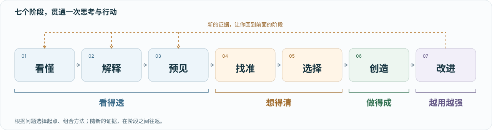

<div align="center">

# OpenXSys：让你的 AI 拥有顶级系统思维的 Skill！

从看懂一家公司，到研究整个产业。让 AI 以系统科学为支撑，像高手一样从根本上思考，看清事物背后的系统。

**主角都有系统。现在，你也有了。**

`[OpenXSys] 叮，系统已激活。`

让 AI 承担复杂性，让人拥有可能性。

[](#status)
[](LICENSE)
[](skills/open-x-sys.zh-CN/SKILL.md)
[](docs/INSTALL.zh-CN.md#tools)
[](#status)

[⚡ 交给 AI 安装](#start) · [✨ 看真实成果](#examples) · [一句话试用](#try) · [为什么不同](#different) · [方法体系](#methods) · [项目结构](#docs) · [官网](https://openxsys.com/?lang=zh) · [English](README.md)

</div>

---

**OpenXSys 是一个开源的系统级 Skill。** Skill 是 AI 可以反复调用的能力包；OpenXSys 把系统思维的方法、判断标准与实践连接起来，让你熟悉的 AI 工具在处理真实问题时直接使用。

你只需问一句，AI 就能从系统角度研究一家公司、一个产业、一项技术，或你面对的复杂问题。它会从整体中找结构，从现象中追原因，找到值得用力的地方，研究适合你的做法，再把认识变成成果。

**看得透 → 想得清 → 做得成 → 越用越强。**

<a id="examples"></a>

## ✨ 一句话，研究整个 AI 产业

**使用：豆包工作 × DeepSeek v4.1 Flash × OpenXSys Skill**

作者在这次实际运行中，只输入了一句：

```text
/open-x-sys 我想研究一下人工智能这整个产业！
```

AI 随后交付了一份可探索的产业研究网页：把应用、模型、云、芯片、存储、封装与电力连成一个系统，追踪资金流与资本循环，分析利润、约束和变化，并展开四种未来情景。页面包含交互图表、方法路线、观察信号、发现卡和来源索引。

[](https://openxsys.com/gallery/ai-industry/index.html)

[📥 下载双语报告，解压后用浏览器打开](gallery/ai-industry/ai-industry-bilingual.zip?raw=true) · [中文 HTML](https://openxsys.com/gallery/ai-industry/index.html) · [English HTML](https://openxsys.com/gallery/ai-industry/index.en.html) · [这次运行的说明](gallery/ai-industry/README.zh-CN.md)

*实际运行日期：2026-11-16。完整双语报告可在页首切换语言，并保留当前章节。数据与来源时点见报告。*

**这个案例展示了系统思维怎样释放模型能力。** Flash 这样的高性价比模型，也能用上系统高手组织问题、追问因果、追踪反馈和寻找瓶颈的研究方式。OpenXSys Skill 把这些方法与系统科学的支撑交给 AI，让原本需要人精心组织提示词、逐层引导的研究，可以从一句日常表达开始。

你也可以换成自己关心的产业、公司、技术或社会现象，从一句话开始。

**下一份让人眼前一亮的作品，可以来自你。** 用 OpenXSys 做出了得意之作？把成果上传到 GitHub，连同你的提示词、使用的 AI 工具和模型，一起提交到项目作品集。

[展示我的作品](gallery/README.zh-CN.md#share-your-work) · [探索这个仓库](#docs)

<a id="start"></a>

## ⚡ 交给你正在使用的 AI 安装

直接把下面这段话复制给你的 AI，里面已包含项目地址；也可以把[完整中文版技能包](dist/open-x-sys.zh-CN.zip?raw=true)交给它：

```text
请从项目仓库 https://github.com/openxsys/open-x-sys 安装 OpenXSys Skill。
请根据你当前所在的 AI 工具，安装完整中文版并完成可用性检查。
安装完成后告诉我已经准备就绪，我会直接说出自己的问题。
```

常见工具入口：[WorkBuddy](docs/INSTALL.zh-CN.md#tools) · [豆包工作](docs/INSTALL.zh-CN.md#tools) · [DSH](docs/INSTALL.zh-CN.md#tools) · [Claude Code](docs/INSTALL.zh-CN.md#tools) · [Codex](docs/INSTALL.zh-CN.md#tools) · 其他支持 Skill 的 AI 工具。

也可以在工具的技能管理中导入完整包。安装方式、更新和卸载都在[安装说明](docs/INSTALL.zh-CN.md)；[英文技能包](dist/open-x-sys.zip?raw=true)同样可用。

<a id="try"></a>

## ✨ 现在，直接问一句

```text
用 OpenXSys，帮我研究人工智能这整个产业。
```

也可以直接问你的问题。你照常说话，AI 根据对象、你的目的与实际条件，选择和组合方法。

| 你想做什么 | 提示词示例 |
|---|---|
| 看懂一个事物 | “给马斯克的企业体系开启一个系统。” |
| 把问题想透 | “把家用储能电池的成本拆到第一性原理。” |
| 找到改善的关键 | “我们反复返工，真正限制交付的是什么？” |
| 做出选择 | “结合我现在的条件，做短视频最合适的路线是什么？” |
| 改进一项工作 | “用马斯克五步法过一遍我们的发布流程。” |
| 做成成果 | “把刚才的发现做成一份能给团队讨论的方案。” |
| 认识自己的系统 | “给我自己开启一个系统。” |

工作展开时，你会看到方法正在做什么。下面是提示的样子：

```text
[OpenXSys] 叮，系统已激活。
[OpenXSys] 运行【透视】：看清 AI 产业，谁创造价值，谁拿走利润？
[OpenXSys] 运行【瓶颈】：如果模型越来越便宜，什么会成为整个产业的下一道约束？
[OpenXSys] 成果已生成：产业全景、关键回路、四种未来，以及可继续探索的研究网页。
```

每一步都服务于当前问题。你可以随时说“换个角度”“先反过来想”“把它做出来”，也可以问“为什么用了这个方法”。

<a id="different"></a>

## 为什么它不同

**OpenXSys 把“怎样认识和改善一个系统”封装成 AI 能使用的一套能力。** 你继续使用原来的模型、智能体、工具和专项 Skill，OpenXSys 把它们组织到你的具体问题中。

高手使用 AI 时，会主动界定问题、补齐关键视角、追问因果，再用证据修正判断。OpenXSys Skill 把这种引导研究的能力变成 AI 可以读取和运用的方法，让你的日常表达也能启动高手级的思考过程。

| 你已有的能力 | OpenXSys 怎样组织和使用 |
|---|---|
| 模型的理解、推理与生成 | 用整体、因果、反馈、约束、尺度与时间，形成对对象的认识 |
| 智能体的检索、规划与执行 | 根据问题选择方法和路线，让前面的发现进入后面的判断与行动 |
| 搜索、数据、工具与专项 Skill | 研究适用条件，比较与连接能力，形成适合当前系统的实践 |
| 你的材料、项目和已有成果 | 积累理解、实践与连接，让下一次从已有基础上继续 |

这套能力有四个相互连接的部分：

- **贯通的思维。** 从看懂、解释和预见，到找准、选择、创造与改进。每个方法页都有适用线索、质量标准、容易出错的地方与思想来源。
- **针对真实条件研究实践。** 同样想用 AI 做视频，独立创作者和团队的路线可以不同；建议会带着依据、成本、适用条件与一个低成本的第一步验证。
- **把认识做成能用的东西。** 一份方案、一个可探索的网页、一段视频、一项工具能力；成果跟着问题与现有能力选择形式。
- **让认识与能力留得下来。** 每次运行留下对对象的理解，也记住你已经理解了什么。下一次回来，接着做，并根据新证据调整。

你得到的是对这个问题的认识、能使用的成果，以及一个可以继续生长的系统。

<a id="results"></a>

## 一次运行，会留下什么

| 留下什么 | 你怎样使用 |
|---|---|
| **一个值得看见的发现** | 看清关键结构、因果与约束，知道判断依据和还有哪些未知 |
| **一份完成的成果** | 用来理解、讨论、行动或分享：网页、文档、方案、演示稿、工具，以及条件具备时的视频 |
| **一条路线条** | 看见用了哪些方法、为什么用，也可以替换或延长其中一步 |
| **适合当前条件的下一步** | 比较实践、权衡选项，先做一个低成本的验证 |
| **一份分享包** | 发现卡、文案草稿与图片说明；有视频能力时包含短片，由你决定怎样分享 |
| **可接续的系统** | 保留认识、实践、能力、资料和成果入口，回来后继续推进 |

<a id="methods"></a>

## 🧠 像高手一样思考

顶尖实践者著名的做法，可以按名字直接用在你自己的任何东西上。

| 高手路线 | 步骤 | 提示词示例 |
|---|---|---|
| **[马斯克五步法](skills/open-x-sys.zh-CN/routes/masters/musk_algorithm.md)** | 质疑每一项要求 → 删除 → 简化 → 加速 → 最后才自动化 | “用马斯克五步法过一遍我们的发布流程。” |
| **[丰田之道](skills/open-x-sys.zh-CN/routes/masters/toyota_way.md)** | 去现场看 → 问五个为什么 → 对策 → 标准化 → 再改善 | “用丰田之道过一遍我们积压的客服工单。” |
| **[高德拉特五步聚焦](skills/open-x-sys.zh-CN/routes/masters/goldratt_five_steps.md)** | 找出约束 → 充分利用它 → 让一切服从它 → 提升它 → 重复 | “我这一周的约束是什么，该拿它怎么办？” |
| **[芒格清单](skills/open-x-sys.zh-CN/routes/masters/munger_checklist.md)** | 反过来想 → 跟着激励走 → 用多个模型 → 多想一层 → 决定 | “用芒格清单过一遍这份工作邀约。” |
| **[费曼学习法](skills/open-x-sys.zh-CN/routes/masters/feynman_technique.md)** | 用简单的话讲出来 → 找到漏洞 → 回到源头 → 再简化 | “用费曼学习法教会我 Transformer 是怎么工作的。” |

还有：**[戴明循环](skills/open-x-sys.zh-CN/routes/masters/deming_cycle.md)**、**[博伊德循环](skills/open-x-sys.zh-CN/routes/masters/boyd_loop.md)**、**[壳牌情景规划](skills/open-x-sys.zh-CN/routes/masters/shell_scenarios.md)**。每条路线的那一页都写明来源，并说明 OpenXSys 在哪里做了简化：[routes/masters](skills/open-x-sys.zh-CN/routes/masters)。

### 从看懂到改进：一条贯通的思考旅程

七个阶段把认识、判断与行动连接起来。AI 根据问题选择起点、组合方法，并随着新证据回到前面的阶段。

<picture>
  <source media="(max-width: 640px)" srcset="assets/readme/journey.zh-CN.mobile.svg" />
  
</picture>

**入门七法。** 每个阶段一个著名的方法。

| 阶段 | 方法 | 提示词示例 |
|---|---|---|
| 看懂 | **[透视](skills/open-x-sys.zh-CN/methods/1-see/xray.md)** | “帮我看透 ___ 背后真正起作用的结构。” |
| 解释 | **[第一性原理](skills/open-x-sys.zh-CN/methods/2-explain/first_principles.md)** | “把 ___ 拆到一定成立的东西，再重新构建。” |
| 预见 | **[反过来想](skills/open-x-sys.zh-CN/methods/3-anticipate/invert.md)** | “什么会让 ___ 失败？” |
| 找准 | **[杠杆](skills/open-x-sys.zh-CN/methods/4-focus/leverage.md)** | “在 ___ 里，哪个小改变最重要？” |
| 选择 | **[最佳实践](skills/open-x-sys.zh-CN/methods/5-decide/practice.md)** | “以我现在的条件，___ 最好的做法是什么？” |
| 创造 | **[做成作品](skills/open-x-sys.zh-CN/methods/6-create/make.md)** | “把它做成一个 ___。” |
| 改进 | **[复盘](skills/open-x-sys.zh-CN/methods/7-improve/review.md)** | “我们来复盘一下 ___：发生了什么，应该改什么？” |

完整方法库包含 **23 个核心方法、7 个进阶视角与 10 种系统模式**。[查看全部方法](skills/open-x-sys.zh-CN/methods)。

**直接说问题，就能开始使用。** AI 会根据任务读取对应的方法与路线文档，选择组合，并在运行提示和路线条中说明采用了什么。你可以跟着结果继续提问，也可以点名方法、自己组合，或打开学习模式，逐步理解和掌握这些思维方式。

**四种使用方式。**

- **说**一句话。系统选择路线，全力运行。
- **选。** 根据结果给出的后续方向，选择你想继续研究或推进的部分。
- **组。** 自己把方法串起来：“先透视，再反过来想。”
- **学。** 边用边学：每份结果都会显示用了哪些方法、为什么用；学习模式会在揭示之前先请你预测。

方法与路线由 AI 根据问题自主选用；你也可以直接点名、组合或替换。完整入口见 [SKILL.md](skills/open-x-sys.zh-CN/SKILL.md)、[日常路线](skills/open-x-sys.zh-CN/routes/everyday.md)和[模式库](skills/open-x-sys.zh-CN/patterns/README.md)。

<a id="system"></a>

## 你自己的系统，越用越强

一个系统的核心是自然语言，也可以包含代码、数据、工具连接与成果。OpenXSys 把这些部分的作用与使用方法说明白，让理解和能力可以在真实工作中积累。

说 **“给我自己开启一个系统。”** OpenXSys 会在你允许的范围内，看你已经有什么，然后把你自己的处境作为一个系统呈现给你：一个结构性的发现、能力鸿沟，以及两到四条适合你已有条件的实践路径。

它了解到的一切，都保存在属于你的纯文本文件里：

```text
~/.openxsys/                 你的系统：跨项目、跨 AI、跨会话
├── SYSTEM.md                根入口：你
└── <开启的系统>/             每个被开启的事物一个文件夹
    └── SYSTEM.md            任何读到它的 AI 都能接着做

<某个项目>/.openxsys/         项目自己的系统，属于项目
```

- 第一次由你选择它放在哪里。你选之前，什么都不会写入。
- 它记下系统认识到了什么，也记下**你**已经理解了什么，所以下一次从你所在的地方开始。
- 它是纯文本。阅读、修改、删除，或者带到任何一个 AI。
- 它从不保存密码、密钥和敏感的个人信息。
- “打开我的系统”会显示你的面板：开启过的系统、正在使用的实践、正在盯住的东西、你已经能独立使用的方法，以及此刻最值得做的一件事。

下一次说“继续”，AI 会从系统入口接上原有认识，查看变化，再提出值得做的下一步。[系统怎样接续](skills/open-x-sys.zh-CN/system/return.md) · [系统由什么构成](skills/open-x-sys.zh-CN/system/parts.md)

<a id="explore"></a>

## 🧭 想再深入一点

- **换一种思维方式。** “把刚才的瓶颈分析换成反过来想，看看多发现了什么。”
- **自己组合。** “先透视，再看激励，最后做一次权衡。”
- **边用边学。** “打开学习模式，解释你为什么这么看。”
- **回到自己的系统。** “打开我的系统，看看现在最值得做什么。”
- **逛试验场。** “打开试验场。”用现成对象、组合、对比和示例系统进一步探索。

[四种使用方式](skills/open-x-sys.zh-CN/use.md) · [试验场](playground/README.zh-CN.md) · [学院](academy/README.zh-CN.md) · [实践](practices/README.zh-CN.md)

<a id="sources"></a>

## 建立在这些思想之上

| 基础 | 它带来什么 |
|---|---|
| **世界由系统构成** | 把任何对象放回组成、关系、边界、约束与变化中认识 |
| **系统思维与顶尖实践者的做法** | 从第一性原理、瓶颈、激励、二阶思考等角度形成判断 |
| **系统科学** | 用反馈、动态、复杂性、边界与尺度，为认识提供骨架 |
| **最佳实践研究** | 发现、比较、适配、组合、创造与持续改善真正适合的做法 |

每个方法页都写明思想来源和 OpenXSys 的简化范围。

<details>
<summary><strong>方法背后的人物与著作</strong></summary>

**实践者。** 亚里士多德（第一原理）· 大野耐一《丰田生产方式》· W. 爱德华兹·戴明《走出危机》· 约瑟夫·朱兰（关键少数）· 艾利·高德拉特《目标》· 查理·芒格《人类误判心理学》· 霍华德·马克斯《投资最重要的事》· 加里·克莱因（事前验尸）· 简·雅各布斯《美国大城市的死与生》· 皮埃尔·瓦克（情景规划）· 约翰·博伊德（OODA 循环）· 克里斯托弗·亚历山大《建筑模式语言》· 根里奇·阿奇舒勒（TRIZ）· 恩里科·费米 · 理查德·费曼 · 费尔南·布罗代尔 · 吉姆·柯林斯 · 钱学森、于景元、戴汝为（开放的复杂巨系统）· 沃尔特·艾萨克森记述的埃隆·马斯克“五步法”。

**系统科学家。** 诺伯特·维纳 · W. 罗斯·阿什比 · 杰伊·W. 福瑞斯特 · 赫伯特·A. 西蒙 · 道格拉斯·恩格尔巴特 · 路德维希·冯·贝塔朗菲 · C. 韦斯特·丘奇曼 · 加勒特·哈丁与埃莉诺·奥斯特罗姆 · 罗伯特·K. 默顿 · 斯塔福德·比尔 · 格雷戈里·贝特森 · 克里斯·阿吉里斯与唐纳德·舍恩 · 海因茨·冯·福斯特 · 彼得·切克兰德 · 维尔纳·乌尔里希 · 爱德华·塔夫特 · W. 布莱恩·阿瑟 · 彼得·圣吉 · 约翰·H. 霍兰 · 德内拉·梅多斯 · 约翰·斯特曼 · 戴维·斯诺登 · 布雷特·维克多 · 杰弗里·韦斯特。

各方法页写明具体来源与转述范围，参见[来源说明](docs/SOURCES.zh-CN.md)。

</details>

<a id="docs"></a>

## 项目文档与结构

### 仓库文件结构

```text
open-x-sys/
├── README.md                    英文项目介绍
├── README.zh-CN.md              中文项目介绍
├── LICENSE                     MIT 许可证
├── VERSION                     机器可读的发布版本
├── CHANGELOG.md                英文更新记录，附中文版
├── .github/                    发布检查与官网工作流
├── skills/
│   ├── open-x-sys/              完整英文版 Skill
│   └── open-x-sys.zh-CN/        完整中文版，与英文版结构对齐
│       ├── SKILL.md            身份、原则、概要与文档索引
│       ├── journey.md          七阶段思考旅程
│       ├── use.md              说、选、组、学四种使用方式
│       ├── methods/            23 个核心方法与 7 个进阶视角
│       ├── patterns/           10 种系统模式及索引
│       ├── routes/             日常路线与 8 条高手路线
│       ├── engines/            研究、理解、创造与持续改进
│       ├── system/             系统入口、认识积累与跨会话接续
│       ├── display/            网页、图表、文档与分享成果
│       ├── styles/             科学、朴素与可选表达风格
│       ├── kit/                扩展能力的连接与选择
│       └── deps/               依赖清单、锁定信息与安装器
├── gallery/                    实际使用产生的成果
│   └── ai-industry/            AI 产业研究：双语网页与运行说明
├── playground/                 现成对象、方法对比与示例系统
├── academy/                    方法课程、人物与学习路径
├── practices/                  带条件、证据与结果的实践
├── x-sys/                      领域系统工具包与兼容性入口
├── evals/                      验证说明、评估贡献与失手反馈
├── docs/                       安装说明、项目概览与来源说明
├── dist/                       可直接导入的中英文完整技能包
├── scripts/                    技能包生成与逐文件核对
├── assets/readme/              旅程图与实际成果预览
└── site/                       项目网站
```

### 按需要查阅文档

以下路径相对于仓库根目录。

| 什么时候看 | 文档 | 路径 |
|---|---|---|
| 安装、换工具、更新或卸载 | [安装说明](docs/INSTALL.zh-CN.md) | `docs/INSTALL.zh-CN.md` |
| 理解完整 Skill 与文档连接 | [运行时入口](skills/open-x-sys.zh-CN/SKILL.md) | `skills/open-x-sys.zh-CN/SKILL.md` |
| 看方法怎样组合 | [日常路线](skills/open-x-sys.zh-CN/routes/everyday.md) | `skills/open-x-sys.zh-CN/routes/everyday.md` |
| 查看成果形式与质量 | [展示规范](skills/open-x-sys.zh-CN/display/signature.md) | `skills/open-x-sys.zh-CN/display/signature.md` |
| 接入其他能力或检查依赖 | [依赖说明](skills/open-x-sys.zh-CN/deps/DEPENDENCIES.md)、[Kit](skills/open-x-sys.zh-CN/kit/KIT.md) | `skills/open-x-sys.zh-CN/deps/DEPENDENCIES.md`、`skills/open-x-sys.zh-CN/kit/KIT.md` |
| 理解项目的结构与工作方式 | [项目概览](docs/OVERVIEW.zh-CN.md) | `docs/OVERVIEW.zh-CN.md` |
| 查看真实运行与验证 | [评估记录](evals/README.zh-CN.md) | `evals/` |

### 给建造者

- **运行时是自然语言。** `SKILL.md` 给出概要与索引，支持文档展开方法、路线、引擎和判断依据；任务需要时，AI 接着读取与运用。
- **Open-X-Sys。** 在内核之上建立 Open{领域}Sys，连接自己的方法与能力：[家族工具包](x-sys/README.zh-CN.md)。
- **Kit。** 为专门需要提供可选连接：[KIT.md](skills/open-x-sys.zh-CN/kit/KIT.md)。
- **技能包。** [生成脚本](scripts/package-skill.ps1)将完整运行时、版本信息与许可证打包，并逐文件核对来源。试验场材料单独保留在仓库中。

<a id="status"></a>

## 0.0.1 Alpha Preview

当前重点是把完整的系统思维能力、低门槛安装和一句话使用体验做实。

| 部分 | 当前进展 |
|---|---|
| 运行时 | 中英文完整版本；23 个核心方法、7 个进阶视角、10 个模式与 8 条高手路线 |
| 安装入口 | 自然语言安装说明与完整 ZIP；隔离目录内的安装、更新、卸载检查 |
| 验证 | 两版支持文档路径、技能包内容、版本与公开链接检查；真实使用记录按工具和模型持续补充 |
| 扩展能力 | 结合当前 AI 工具与已有 Skill；锁定依赖的审查进展见依赖说明 |
| 展示 | 已有豆包工作的一句话产业研究；中英文报告可切换，作品集和回放持续整理 |

首个公开版本为 `0.0.1-alpha.1`。[验收记录](evals/README.zh-CN.md) · [更新记录](CHANGELOG.zh-CN.md)

<a id="faq"></a>

## 常见问题

**我不懂系统思维，也不会写提示词，怎么用？**

直接说你关心的事。方法与路线由 AI 根据问题选择；你可以从看到的发现和结果继续提问，随时换方向。

**它和我正在用的 AI 工具是什么关系？**

你继续使用原来的工具。OpenXSys 为它提供系统思维与接续工作的能力，模型、对话、文件操作和工具调用由你选择的 AI 工具承担。

**我的其他 Skill 还能用吗？**

可以。OpenXSys 会结合当前任务，研究和连接已有工具、数据与专项 Skill，形成适合你的实践。

**要花多少钱？**

OpenXSys 采用 MIT 许可证开源。运行消耗你所用 AI 工具的用量；视频、动画或其他扩展沿用相应工具和依赖的条款。你随时可以说“简短版”或“只要答案”。

**我的系统放在哪里？**

第一次保存时由你选择跟着自己走，或只留在项目里。系统是你能阅读、修改、删除与带走的文件；数据处理沿用你选择的模型和宿主的规则。

**能做视频、演示稿、文档和图表吗？**

它会根据需要组织这些成果，并调用当前可用的能力。具体环境和扩展状态见[依赖说明](skills/open-x-sys.zh-CN/deps/DEPENDENCIES.md)。

**怎样更新或卸载？**

直接让 AI “更新 OpenXSys，保留我的系统和成果”，或“卸载 OpenXSys，保留我的系统和成果”。[安装说明](docs/INSTALL.zh-CN.md)提供具体方式。

<details>
<summary>文件、分享与行动的约定</summary>

系统从你的工作区、宿主已经提供的内容和你指定的材料开始。保存位置、扩大读取范围和对外行动由你决定。个人系统、工作文件与安装的 Skill 分别管理，密码和密钥沿用原有凭证管理方式。

分享包交给你使用；发布、花费、联系他人和定期运行等行动，依照你的授权和当前工具的权限完成。完整约定见[同意、隐私与分享](skills/open-x-sys.zh-CN/system/consent.md)。

</details>

<a id="contribute"></a>

## 🛠️ 一起把它做得更好

最有价值的贡献，是一份实际使用的结果：你说了什么，得到了什么，哪里让你惊喜，哪里还需要改进。

分享成果、报告失手、翻译、写方法课、分享实践、审查依赖，或者带着真实运行提出一个新方法，都有清楚的入口。

[参与贡献](CONTRIBUTING.zh-CN.md) · [分享成果](gallery/README.zh-CN.md) · [报告失手](evals/misses/README.md) · [领域系统](x-sys/README.zh-CN.md)

---

<div align="center">

**给任何事物，开启一个系统。给自己，开启一个系统。**

⭐ 给项目点星 · 用 **#OpenXSys** 分享你的第一个发现 · [MIT 许可证](LICENSE)

</div>
